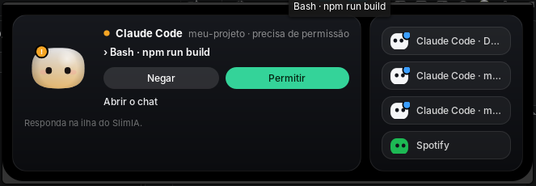

# SlimIA

Um bichinho animado (o **Mochi**) que fica na barra superior do seu computador e acompanha o que o Claude Code, o
Codex, o Gemini CLI, o Cursor e outros agentes de código estão fazendo. Ele mostra o que o agente está fazendo,
avisa quando termina, deixa você **permitir ou negar** pedidos de permissão sem abrir o terminal, controla o
**Spotify** e tem uma página de **Chat** com o que o Claude respondeu, como o painel da extensão do VS Code.

**Tudo local: nada entra e nada sai do computador.** Não há rede, voz, celular, nuvem nem atualização automática.

## Amostra

A cápsula na barra superior (aqui com um pedido de permissão esperando: a borda pulsa em laranja) e o popup que
abre ao clicar nela, com **Negar** e **Permitir**:

<p>
  
</p>



## O que ele faz

| | |
|---|---|
| **Mochi na barra** | Uma cápsula na barra superior com o Mochi e mini-Mochis para os outros agentes e o Spotify. Ele pensa, trabalha, pede permissão, faz pergunta, comemora, erra, cansa com o limite de uso e dorme, com as animações da ilha original. Os olhos seguem o mouse. |
| **Permitir / Negar** | Quando o Claude Code pede permissão, o Mochi pula e a borda pulsa em laranja até você decidir. Clique na cápsula e use **Permitir** ou **Negar**. |
| **Avisos** | Som e animação quando um agente termina. |
| **Passos ao vivo** | O popup mostra as últimas etapas do agente (`Edit · main.rs`) e a última resposta dele. |
| **Spotify** | Música atual, anterior, play/pause e próxima, direto no popup. Botão do meio na cápsula dá play/pause; a roda troca entre agentes e Spotify. |
| **Chat** | Página da janela que lê as conversas do Claude Code em `~/.claude/projects` (somente leitura). **Limpar lista** só esconde as conversas antigas da tela, sem apagar nada. |

As perguntas de múltipla escolha do Claude Code (`AskUserQuestion`) **não** são respondidas pela barra: caem no
terminal.

## Garantias de ser local

- **Nada entra:** não há servidor, porta, link com celular nem WhatsApp. Só o canal local (pipe) que os hooks dos
  agentes usam escuta, neste computador.
- **Nada sai:** o programa não tem cliente HTTP. A política de conteúdo das janelas não permite nenhum endereço de
  fora, e a página do Mochi na barra roda num WebKit efêmero que só abre o próprio arquivo.
- **Sem voz:** sem ditado, sem microfone, sem modelo de fala.
- **Segunda trava, pelo sistema:** [windows/firewall/](windows/firewall/README.md).
- O indicador da barra só lê um arquivo local (`~/.local/share/coucou/status.json`) e só executa o app com
  `--shortcut openChat`, `--spotify <ação>` e `--decide allow|deny <pedido>`.

## Instalar (Linux, testado no elementary OS 8 / Pantheon)

Precisa de Rust, Node 20+ e, para o indicador da barra: `meson`, `valac`, `libwingpanel-dev`,
`libwebkit2gtk-4.1-dev`, `libgee-0.8-dev`, `libjson-glib-dev`.

```sh
cd windows
npm install
npx tauri build --no-bundle          # gera windows/target/release/coucou
GDK_BACKEND=x11 ./target/release/coucou
```

1. Abra **Configurações → Agentes** e instale o hook do Claude Code (e dos outros agentes que usar).
2. Em **Configurações → Integrações**, ligue o **Spotify** se quiser os controles.
3. Para o Mochi na barra superior do Pantheon:

```sh
cd windows/wingpanel-indicator
./install.sh        # pede sua senha pelo diálogo do sistema e reinicia a barra
./uninstall.sh      # para tirar
```

Com o indicador instalado, a janela da ilha **não é mostrada**: o app segue rodando por trás (recebe os eventos
e executa suas respostas) e o Mochi aparece só na barra. Em outros desktops, sem o indicador, a ilha aparece
no topo da tela como no projeto original.

No **Windows** o app usa a ilha no topo da tela. O build para Windows está no código, mas **não foi testado**
nesta versão.

## Estrutura

```
windows/
  src/                  front-end (TypeScript): ilha e janela (Chat, Geral, Agentes, Integrações)
  src-tauri/            backend (Rust): hooks, canal local, Spotify, status.json
  hook/                 coucou-hook: o relé que os agentes chamam
  wingpanel-indicator/  indicador da barra (Vala + página do Mochi em web/)
  firewall/             scripts para bloquear a rede pelo sistema
```

Os nomes internos continuam `coucou` (comando, pasta `~/.config/coucou`, `coucou-hook`) para não quebrar hooks
já instalados nem configurações.

## Testes

```sh
cd windows
npx tsc --noEmit && npm test
cargo test --workspace
```

## Licença

O código é MIT (veja [LICENSE](LICENSE)). O nome, o personagem e as ilustrações têm termos próprios: veja
[LICENSE-ASSETS.md](LICENSE-ASSETS.md) antes de redistribuir.
